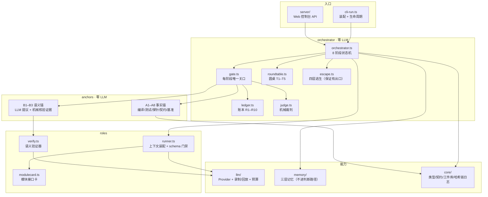

# 02 · 系统架构

## 一句话

**编排内核零 LLM，LLM 只在自己那一格里干活；所有"是否算完成"的判断都由确定性代码做出。**

## 一、分层与职责



| 层 | 包 | 关键性质 |
|---|---|---|
| 编排 | `orchestrator` | **没有任何 LLM 调用**。这是可审计性的前提：判断逻辑不可能被模型带偏 |
| 验收 | `anchors` | A 层 8 条事实锚（机械）+ B 层 3 条语义锚（LLM 提议 + 机械核验） |
| 角色 | `roles` | 把角色变成"一次受 schema 约束的模型调用"，上下文在代码里装配（不靠提示词自律） |
| 能力 | `llm` / `memory` / `core` | Provider 抽象、录制回放、三层记忆、工件库与哈希链日志 |

## 二、为什么这样切（三条设计决定）

### 决定 1：编排内核不含 LLM

`orchestrator` 里没有一次 `provider.complete()`。所有"下一步做什么"都由状态机 + 机械判定得出。

**为什么**：如果编排里也有 LLM，"为什么这个项目没做完"就永远说不清 ——
可能是模型判断错，也可能是编排判断错，而后者会被前者的表象掩盖。
我们为此立了一条不变式：**no LLM calls in orchestrator**。

**代价**：编排的能力上限受限于"能被机械表达的东西"。
所以复杂协商被显式放进 `roundtable`（那是唯一允许 LLM 讨论的地方），而不是散落在流程里。

### 决定 2：只有一个关口（Gate），8 个阶段共用一个

```
INTAKE → PLANNING → CONTRACTING → BUILDING → REVIEW → DELIVERED
                                            ↘ ROUNDTABLE → ARBITRATION ↗
```

每个阶段结束时**必须**过一次 Gate，Gate 输出唯一的 `NextAction`：

| NextAction | 含义 |
|---|---|
| `ADVANCE` | 进入下一阶段 |
| `RETRY_ROLE` | 机械归因成功 → 生成派工单打回 |
| `ROUNDTABLE` | 需要协商（触发条件 T1–T5） |
| `ARBITRATE_HUMAN` | 升级真人裁决 |
| `PASS_WITH_DEBT` | 记账后带债通过（不掩盖、不卡死） |
| `HOLD` | 真人按下暂停（任何机器人不能越过） |

**为什么"一个关口"很重要**：如果每个阶段有各自的通过标准，标准就会漂移，
而且会出现"上一个阶段放过了、下一个阶段才发现"的责任真空。
现在所有阶段的判定都走同一个函数，锚点集合由 `STAGE_ANCHORS` 声明式配置：

| 阶段 | 锚点 |
|---|---|
| INTAKE | （无 —— 只把原始诉求变成可验收的需求） |
| PLANNING | B2 |
| CONTRACTING | A7、B2 |
| BUILDING | A1 A2 A3 A4 A5 **A7** A8 B2 |
| REVIEW | 全部 11 条（含 A6 运行时探针、B1 达成、B3 异议核验） |
| DELIVERED | 全部事实锚 + B1 + B2 |

> 注意 **A7 在 BUILDING 就启用**。这是被真实缺陷纠正的：原本契约检查只在 REVIEW 跑，
> 那时返工成本已经付出去，中间几轮 Gate 是**盲的**。而 A7 是纯静态检查（不编译、不跑测试、不花 token），
> 提前到 BUILDING 的代价接近 0 —— 这条改动直接决定了我们能在**第一轮**就发现"写了没接线"。

### 决定 3：零依赖，Node 原生跑 TypeScript

- 引擎自身 **0 个运行时依赖**：靠 Node ≥ 24 的类型剥离直接执行 `.ts`
- 无 `npm install` 也能跑测试（用内置 `node:test` 与自研轻量 runner）
- CI 断言 **仓库根目录不存在 `node_modules`**，防止依赖偷偷混进来

**为什么**：这类系统最怕"评审时跑不起来"。零依赖意味着**换一台机器、克隆下来就能复现**。
代价是自己写了一些轮子（dotenv、JSON Schema 校验、strict 化转换、测试 runner），
但这部分正好也是"可复现"的代价里最值的一块。

## 三、数据流：一次产出的完整路径

```
角色 runner.produce()
  ├─ 装配上下文（selectContext）
  │    ├─ 读权限矩阵 READ_PERMISSIONS 过滤（代码里过滤，不靠提示词自律）
  │    ├─ 五层配额分配（规格/执行事实/模块接口/代码全文/需求计划）
  │    ├─ 契约放不下 → 确定性摘要；模块 → 接口卡
  │    └─ 产出 LlmContextReport（注入了什么、丢了什么、为什么）→ 落进 run 日志
  ├─ 调用 LLM（strict json_schema）
  ├─ schema 校验（失败 → 把具体错误回喂，最多 N 次）
  └─ 发布工件（绑定内容哈希 + 锚点链）
        ↓
     Gate 跑锚点（A 层机械 / B 层提议+核验）
        ↓
     机械归因 → 工单 / 圆桌 / 升级 / 带债 / 前进
```

## 四、代码规模（`[实测]`）

| 指标 | 值 |
|---|---|
| 包 | 7（core / llm / roles / anchors / orchestrator / memory / server） |
| 追踪文件 | 149 |
| TypeScript 文件 / 行数 | 120 / 39,033 |
| 测试文件 / 用例 | 24 / **398** |
| 锚点 | 11（A1–A8 + B1–B3） |
| 靶场样本 | 45（30 注入 + 15 干净对照） |
| 提交 | 32 |

## 五、答辩可能被问到的架构问题

**Q：为什么不用现成的 Agent 框架（LangGraph / CrewAI / AutoGen）？**
A：它们解决"怎么让 Agent 干活"，我们要解决"怎么判断干完了没有、没干完怪谁"。
后者需要**可复现的机械判定**，而现成框架的判定通常也是 LLM 驱动的 —— 那就回到了"谁来裁判裁判"。
我们用的是它们的思想（角色分工、消息传递），但判定层是自己写的确定性代码。

**Q：状态机是不是太僵硬？真实研发不是线性的。**
A：是僵硬，这是刻意的。**能机械表达的部分必须僵硬**（否则不可复现），
需要灵活性的事情被显式放进圆桌（唯一允许 LLM 协商的地方）。
我们宁可"某些情况下多开一次会"，也不要"每次跑出来的判定标准都不一样"。

**Q：零依赖是不是为了比赛好看？**
A：不是设计初衷，但是一个真实的工程收益：这套系统要在评审电脑、队友电脑、CI 三处跑出同样结果。
零依赖把"环境问题"这一类失败直接消掉了 —— 我们踩过 `npm install` 在受限环境下失败的坑，
那次失败看起来像"模型不会写代码"，实际是工具链没装好。
