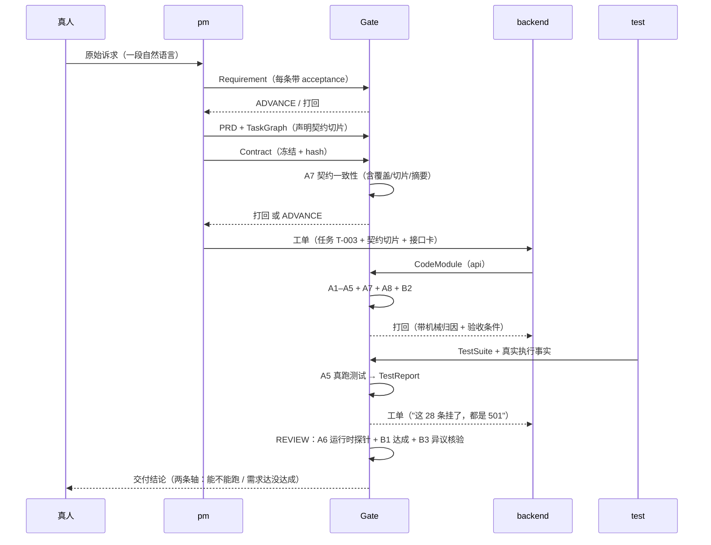

# 03 · Agent 协作链路

## 一句话

**五个角色不直接对话，只通过"工件 + 读权限矩阵"通信 —— 谁能看到什么由代码强制，不靠提示词自律。**

## 一、五个角色与它们的交付物

| 角色 | 产出 | 关键约束 |
|---|---|---|
| **pm（产品）** | Requirement（需求集）→ PRD → TaskGraph（任务图）→ **Contract（冻结契约）** | 每条需求必须有可验收条件；契约冻结后带内容哈希，任何一方不得单方面改动 |
| **backend** | CodeModule（scope=api） | 相对导入必须带 `.ts` 扩展名；不得附带 `package.json` 等基准文件 |
| **frontend** | CodeModule（scope=web） | 同上；所有请求路径必须来自契约 |
| **test** | TestSuite + 测试执行事实 | 测试必须真的执行（`A5` 会跑），且必须覆盖声明的需求（`B2` 检查 `covers`） |
| **host（主理人）** | AnchoredReview（异议） | **有界阻断权**：同一阶段阻断 3 次后权限自动终止 |

> 注意没有"集成者"角色。这是当前设计的一个已知缺口（见 `04` 与 `09`），
> 我们用别的机制补（`unwired-handler` 锚点 + 集成任务），而不是加第六个角色。

## 二、通信的六种通道

### 通道 1：工件库（唯一的正例通信）

角色之间**不传递消息**，只往工件库发布工件。每个工件有：版本、内容哈希、锚点链、生产者。

```
【你可读的工件（这就是你与其他角色之间的全部通信内容）】
--- 工件 Contract-001（Contract by pm v1）---
...
```

### 通道 2：读权限矩阵（决定"看不到什么"）

```ts
READ_PERMISSIONS = {
  pm:       [Requirement, PRD, TaskGraph, Contract, TestReport, Directive, DebtRecord, AnchoredReview],
  backend:  [Requirement, PRD, TaskGraph, Contract, CodeModule, TestSuite, TestReport, Directive],
  frontend: [同上],
  test:     [同上],
  host:     [全部 —— 但要审查就必须看得全]
}
```

**关键点：过滤发生在代码里，不在提示词里。** 我们不会写"请不要看别人的代码"——
它根本拿不到。这样"越权访问"在物理上不可能发生，而不是靠模型自觉。

> 这条矩阵本身也踩过坑：`TestReport` 曾经**漏配**给 test 角色，
> 导致语义验证器每一轮都如实报"上下文中不存在任何测试文件与 npm test 输出"，
> 45% 的需求判定落在 uncertain —— 而那个事实系统本来就有。

### 通道 3：契约（唯一"必须送到"的工件）

- 契约冻结后带 `frozenHash`，下游工件必须绑定同一个 hash
- 契约太大时**压缩成确定性摘要**（只保留方法/路径/状态码/字段类型），实测 66k → 2.7k 字符（**4%**）
- PM 可以在任务图里声明 `contractPaths` / `contractSchemas`，实现**按任务切片**：
  实现"论文模块"的任务只拿到论文相关端点，不拿全部 17 个

**为什么切片需要配一条覆盖检查**：切分带来一个新的静默失败 ——
**某个端点没有被任何任务认领**，于是永远不会被实现。
所以 `A7` 会检查"每个契约端点都被至少一个任务认领"，把"装不下"换成"没人认领"是不允许的。

### 通道 4：模块接口卡（代码层的"只传接口"）

这是本项目最核心的一条规则在代码层的落地。

**问题**：`README` 里写着"模型之间的信息传递只传接口"，
但 `READ_PERMISSIONS` 实际给代码角色的是 `CodeModule` **完整源码**。规则和实现不一致。

**两种极端都不对**：
- 给全文 → 违反切分原则，而且装不下就变成"随机看不见任何人"
- 不给 → 不可能接线（`app.ts` 的作者不可能知道 `papers.ts` 导出了 `handlePapersRoute`）

**接口卡**：只抽取导出签名，不给实现。

```
--- 接口 CodeModule-T-003（CodeModule/api by backend v1）---
@@@ 模块 CodeModule-T-003 v1
@@ src/api/papers.ts
export function handlePapersRoute(request: PapersRequest): PapersResponse | null
export function listPapers(): PaperRecord[]
export function createPaper(input: unknown): PapersResult<PaperRecord>
export interface PaperRecord
```

实测：11 个模块的全部签名 ≈ **5 千字符**，全文 **20 万字符** —— **40 倍**差距 `[实测]`。

### 通道 5：工单（负例通信，必须可执行）

角色收到工单，不是"你去看看哪里不对"，而是带**验收条件**的指令：

```
你收到一张派工单 WO-0007，必须修复下列问题。
验收条件（必须逐条满足）：
  1. 把 src/api/papers.ts 的 handlePapersRoute() 接入请求分发逻辑
     （路由表里要真的调用它），使「发一个真实请求」能走到这段代码；
     **加 export 别名不算接线**。使 A7 锚点 PASS
问题详情：
  { "code": "unwired-handler", "handler": "handlePapersRoute", "reason": "export-only" }
```

**这条验收条件的措辞是被真实失败逼出来的**：模型曾经用
`export const papersRouter = handlePapersRoute;` 制造"接线假象"，
所以验收条件里必须明确写"加 export 别名不算接线"。

### 通道 6：圆桌会议（唯一的多对多协商）

两轮发言：

1. **第一轮**：每个参与者陈述主张 + 证据（证据必须指向自己**确实看到过**的工件）
2. **第二轮**：只能针对其他人的主张回应，不能引新证据

产出必须过 schema 校验，且行动项必须绑定到具体角色。
触发条件 T1–T5（不可被任何角色否决）：

| 触发 | 含义 |
|---|---|
| T1 | 主理人本阶段阻断已达 3 次上限 |
| T2 | 主理人无法归因给具体角色（`UNRESOLVED`） |
| T3 | 两个角色对同一工件给出互相矛盾的产出 |
| T4 | **机械归因完全失灵**：一条能派出去的工单都生成不了 |
| T5 | 契约变更请求影响 ≥2 个角色且无人认领 |

> T4 的语义改过一次：原本是"归因分散"，而"分散"根本不需要开会 ——
> 派工单天然支持一次派给多个角色。实测 12 轮里开了 15 场圆桌，绝大多数毫无必要。
> 现在只有"真的无人可派"才开会。

## 三、一次协作的时序（真实路径）



## 四、这套协作方式的三个不变量

1. **LLM 永远不是最终裁判** —— 角色能做的只是"提议"和"产出"
2. **主理人无法让项目停死** —— 阻断权有界，逃生阶梯保证有出口
3. **经验库永不进判断路径** —— 跨 run 的记忆只影响"提示词里的历史教训"，
   不参与任何判定。这是防"错误经验污染机器判决"

## 五、答辩可能被问到

**Q：五个角色会不会互相甩锅？**
A：会，所以我们不靠"说服"解决。只要能机械归因就先各自派工单（可以同时派给双方），
真的归不了因才开会。**甩锅是可以被派工单化解的** —— 这是实测得出的结论，不是设计时的假设。

**Q：角色之间看不到彼此，会不会导致各写各的？**
A：会，这正是我们踩到的最大的坑。所以现在有一条硬规则：
**接口（契约 + 模块签名）保证送达，实现（代码全文）尽力而为**。
契约和接口卡不会因为预算不够而被丢掉 —— 它们是"接线"的物理前提。

**Q：为什么不让后端直接看前端代码？**
A：因为它不需要。它需要知道"前端会调哪些端点"（这在契约里），
而不是"前端怎么写那个按钮"。**传递的信息量应当等于协作所需的信息量**，
多给只会稀释注意力、增加成本。
