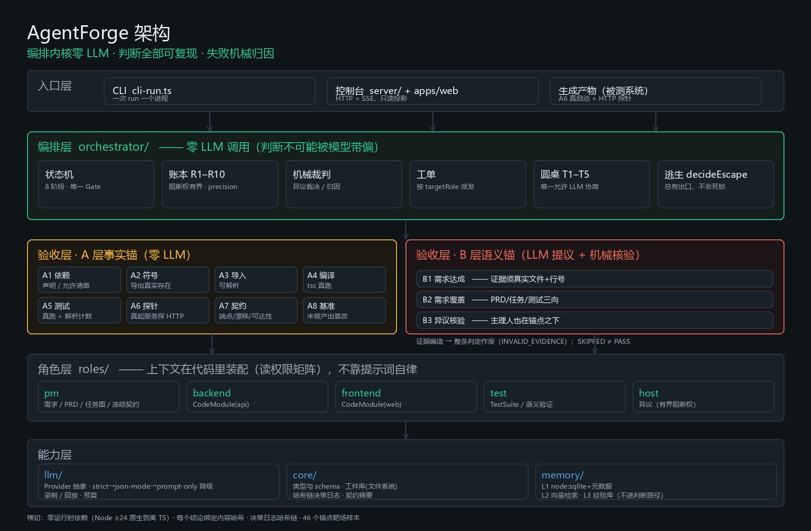
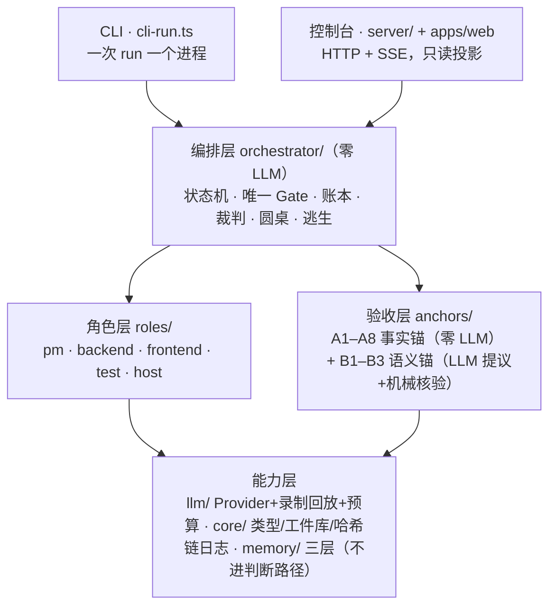
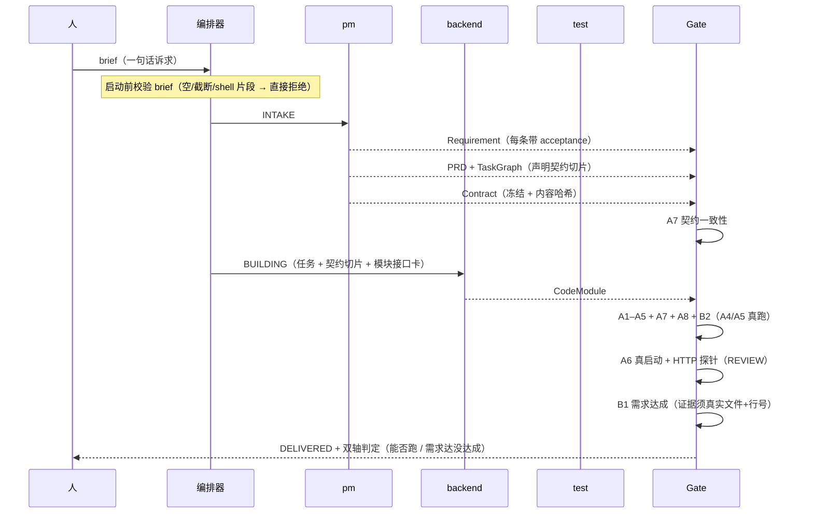

# 11 · 系统架构设计文档

> 面向评委与工程复验：这份文档回答「它由什么组成、为什么这么切、每处选型的代价是什么」。
> 所有数字标 `[实测]`（来自本仓库真实代码/运行），其余标 `[设计]`（结构可见，未做统计验证）。
> 图：`evidence/architecture.png`（本文末尾也有 Mermaid 版本）。

---

## 1. 目标与三条硬约束

AgentForge 要解决的不是「能不能生成代码」，而是**生成结果能不能被验证、被复核、被反复交付**。

由此推出三条约束，它们决定了后面几乎所有选型：

| 约束 | 含义 | 直接后果 |
|---|---|---|
| **C1 零运行时依赖** | 引擎（`packages/*`）不装任何 npm 包，Node ≥24 直接跑 `.ts` | 克隆即跑、换机器即跑；自己写 dotenv / JSON Schema 校验 / strict 转换 / 测试容器 |
| **C2 判断必须可复现** | 任何「是否通过」的结论都必须能重算 | **编排层里没有一次 LLM 调用**；结论绑定内容哈希 |
| **C3 失败必须可归因** | 每个失败要能落到具体角色 | 每条锚点结论带 `targetRole`，直接生成工单 |

> C2 是最重要的那条：如果判定也由模型做，系统就只能回答「模型觉得行」，
> 而无法回答「为什么不行、谁该改」。这是本项目与「多 Agent 框架」的分水岭。

---

## 2. 总体架构





分层与行数 `[实测]`：

| 层 | 包 | 文件 | 行数 | 职责 |
|---|---|---|---|---|
| 编排 | `orchestrator` | 25 | **11,641** | 8 阶段状态机、Gate、账本、裁判、圆桌、逃生、CLI |
| 验收 | `anchors` | 12 | 6,476 | A1–A8 事实锚、B1–B3 语义锚、靶场 |
| 记忆 | `memory` | 15 | 5,077 | SQLite 事实层、向量检索、经验库 |
| 基础 | `core` | 22 | 4,852 | 类型/schema、工件库、哈希链日志、契约摘要、dotenv、exec |
| 模型 | `llm` | 13 | 3,895 | Provider 抽象、录制回放、预算、strict 转换 |
| 角色 | `roles` | 9 | 2,329 | 上下文装配、模块接口卡、语义验证器 |
| 控制台后端 | `server` | 6 | 1,778 | 只读 API + SSE + run 管理 |
| 控制台前端 | `apps/web` | 8 | 1,784 | React + Vite（唯一需要 npm 的部分） |

引擎合计 **102 个文件 / 36,048 行**；根 `package.json` 的 `dependencies` 为空 `[实测]`。

---

## 3. 核心组件

### 3.1 `core` — 基础类型与不可变事实

| 组件 | 关键点 |
|---|---|
| `types.ts` / `schemas.ts` | 11 种工件的内容 schema；自研 JSON Schema 校验（C1 的代价与收益） |
| `store.ts` | **工件库**：文件系统实现，一个工件一个 JSON，版本号 + 内容哈希 + 锚点链 |
| `decisionlog.ts` | **决策日志**：JSONL + 哈希链，写入串行化保证磁盘顺序 == seq 顺序 |
| `contractdigest.ts` | **契约摘要**：把 6.6 万字符的契约压到 4%–6%，并做按任务切片与覆盖检查 |
| `dotenv.ts` / `exec.ts` | 零依赖 .env 加载；子进程执行（含 Windows 命令解析与超时树杀） |

> 为什么用文件系统而不用数据库：工件是**交付物本身**（人要能直接读、能进 git、能被打包带走）。
> 用它做数据库只解决了「查询」，却丢掉了「可携带」。记忆库另用 SQLite，因为它不需要被携带。

### 3.2 `llm` — 模型接入与可复现

- **Provider 抽象**：OpenAI 兼容 / Ollama / Mock，统一 `complete(LlmRequest)`；
- **能力探测与降级**：`strict(json_schema)` → `json-mode` → `prompt-only` 三级，实测网关支持 strict；
- **strict 兼容转换**：可选字段 → `required + nullable`，`oneOf` → `anyOf`；
- **录制 / 回放**：每次调用落盘（prompt 哈希 + 用量 + 耗时），可按 `purpose|promptHash|attempt` 回放；
- **预算**：按角色与全局统计 token / 成本，超限按策略停。

### 3.3 `roles` — 把「角色」变成一次受约束的调用

三个机制：

1. **读权限矩阵**（`READ_PERMISSIONS`）：谁能读哪些工件，**在代码里过滤**，不靠提示词自律；
2. **上下文分层配额**：规格 → 执行事实 → 模块接口 → 代码全文 → 需求计划，关键三类保证送达；
3. **schema 门禁 + 结构化重试**：校验失败把**具体错误**回喂，而不是盲目重试。

> `modulecard.ts`（模块接口卡）是这个包里最能说明设计取向的组件：
> 只抽导出签名，不给实现。实测 11 个模块签名 ≈ 5 千字符，全文 20 万字符 —— **差 40 倍**。

### 3.4 `anchors` — 11 条锚点（系统的裁判）

| 锚点 | 判什么 | 是否真跑命令 |
|---|---|---|
| A1 | 依赖声明与允许清单 | 否（解析） |
| A2 / A3 | 导出符号真实存在 / 导入可解析 | 否（解析） |
| **A4** | 类型检查 | **真跑 `tsc`** |
| **A5** | 测试执行 | **真跑测试套件并解析通过/失败数** |
| **A6** | 运行时探针 | **真启动服务 + HTTP 探针** |
| A7 | 契约一致性（端点/漂移/可达性） | 否（静态） |
| A8 | 验证基准未被产出篡改 | 否（比对哈希） |
| **B1 / B2 / B3** | 需求达成 / 需求覆盖 / 异议核验 | 否（LLM 提议 + 机械核验证据） |

每条结论带 `subjects`（涉及的工件 id）、`contentHashes`、`method`、`authority`、耗时。
靶场 46 个样本标定这 11 条锚点本身：**TP 30 / FN 0 / FP 0 / TN 16 / 严重度不符 0** `[实测]`。

### 3.5 `orchestrator` — 唯一会「做决定」的地方（零 LLM）

```
INTAKE → PLANNING → CONTRACTING → BUILDING → REVIEW → DELIVERED
                                          ↘ ROUNDTABLE → ARBITRATION ↗
```

- **每阶段只过一个 Gate**，输出唯一的 `NextAction`：`ADVANCE / RETRY_ROLE / ROUNDTABLE / ARBITRATE_HUMAN / PASS_WITH_DEBT / HOLD`；
- **账本 R1–R10**：主理人阻断权有界（同阶段 3 次后终止）、precision 统计、观察期；
- **逃生**：`decideEscape()` 是纯函数，三分支穷举 → **一定有出口**；
- **收敛**：以「失败签名」（`锚点:code:文件:行`）判断修复是否有效，签名不变即转逃生。

### 3.6 `memory` — 三层记忆（**永不进判断路径**）

| 层 | 实现 | 用途 |
|---|---|---|
| L1 事实 | `node:sqlite` + 元数据（FTS5 实测可用） | 每次 run 的锚点结论、工件版本 |
| L2 检索 | 自研 `LocalHashEmbedding`（零依赖）；fastembed 可选但**不作为依赖** | 相似历史检索 |
| L3 经验 | 候选簇 → 提案 → 生效，可被证伪 | 注入 frontend/backend/test 的提示词 |

> **PM 与 host 不在注入白名单**：两者的产出是判定基准，收到经验会改变**判定性质**，不只是改变产出。
> 这条不变式与「LLM 不是最终裁判」是同一件事的两种表述。

### 3.7 `server` + `apps/web` — 控制台

- 后端：`node:http`，只读 API（`/api/state`）+ SSE（`/api/events`）+ 三个写操作（启动 run / 提交建议书 / 暂停）；
- 前端：React 19 + Vite 8，构建产物由后端静态托管（`apps/web/dist`）；
- **判定在服务端**：`deriveVerdict()` 是双轴判定（机械轴 + 需求轴）的唯一实现，前端只渲染不计算。

---

## 4. 服务拆分与进程边界

**没有采用微服务**。拆分依据是「谁需要独立生命周期」，不是「谁看起来像一个服务」。

| 进程/边界 | 是什么 | 为什么独立 |
|---|---|---|
| **引擎进程** | 一次 run 一个进程（`cli-run.ts`） | run 的状态是进程内的；崩溃即失败，不留半死状态 |
| **控制台进程** | `server/cli.ts`（HTTP + SSE） | 要能在 run 之外活着（人有时间看、能重连、能回看历史） |
| **前端** | 静态产物（`apps/web/dist`） | 生产不需要 node 侧渲染；构建一次，任何地方托管 |
| **生成产物** | 被测系统自己起进程 | A6 必须**真的连一个活的服务**，不能在引擎进程内伪造 |
| **记忆库** | SQLite 文件（进程内打开） | 需要事务与查询，但不需要独立进程 |

**为什么不做成多服务**：一次 run 的判定要在**毫秒级**读同一份工件与账本。
拆成服务只会把「函数调用」换成「网络调用 + 一致性协商」，而判定必须确定、不能有最终一致性窗口。
真正需要独立的是**人机边界**（控制台）与**被测边界**（A6），这两处已经拆开。

---

## 5. 一次 run 的时序



---

## 6. 技术选型与理由

| 选择 | 替代方案 | 理由 | 代价 |
|---|---|---|---|
| **Node 24 原生剥离 TS** | ts-node / tsx / 打包器 | 零依赖、零构建、克隆即跑 | 不能用 enum / 装饰器 / 参数属性；`import` 必须带 `.ts` |
| **`node:test`** | jest / vitest | 零依赖；`--test-force-exit` 能兜住泄漏句柄 | 报告格式要自己解析（A5 做这件事） |
| **`node:sqlite` + FTS5** | better-sqlite3 | 零依赖（Node 内置） | 新 API，行为需实测（已验 FTS5 可用） |
| **自研 JSON Schema 校验** | ajv | 只支持用到的子集，报错信息可定制（要给模型回喂） | 需自己实现 `$ref`/`oneOf` 等子集 |
| **自研 dotenv** | dotenv | 零依赖；**只报键名不报值**（防泄露） | 不支持变量展开 |
| **工件库 = 文件系统** | PostgreSQL / MongoDB | 交付物要能被读、进 git、打包带走 | 无事务、查询弱（用目录扫代替） |
| **决策日志 = JSONL + 哈希链** | 数据库审计表 | 任何人可验证未被篡改；顺序与 seq 一致 | 需自己保证写入串行化 |
| **控制台 = React + Vite** | 全自研零依赖 UI | 只影响开发者体验，不影响判定 | 唯一需要 `npm install` 的部分；刻意**不放进 workspace** |
| **SSE** | WebSocket | 单向推送足够；HTTP 语义简单、断线可重连 | 不能双向（写操作走普通 POST） |
| **确定性锚点** | LLM-as-judge | 判定必须可复现、可归因（C2/C3） | 只能判「可机械表达」的性质（判不了 UI 好不好看） |
| **契约摘要 + 接口卡** | 全量注入上下文 | 实测 24k 预算下关键工件全被挤掉 | 摘要有信息损失（丢掉约束/枚举） |

---

## 7. 关键设计决策（ADR 摘要）

### ADR-1 编排内核不含 LLM
- **背景**：如果编排也算模型能力，「为什么没做完」永远说不清。
- **决定**：`orchestrator/` 内零 `provider.complete()`；协商只发生在圆桌（显式、可记录）。
- **否决**：让 LLM 决定下一步动作（更灵活，但判定不可复现）。

### ADR-2 八个阶段共用一个 Gate
- **决定**：所有阶段的通过标准由 `STAGE_ANCHORS` 声明式配置，判定走同一个函数。
- **理由**：多套标准必然漂移；单 Gate 让「上一个阶段放过了、下一个阶段才发现」不可能发生。

### ADR-3 上下文分层配额（**否决了「加预算」**）
- **背景** `[实测]`：24,000 字符预算被「需求 + PRD + 任务图」吃掉 95%，契约/代码/测试报告一件没进。
- **第一反应**：把预算提到 60 万，全部语料一次塞进去。
- **为什么否决**：那等于取消「切分小任务 + 只传接口」的初衷，下一个更大的项目会再次溢出。
- **决定**：预算提到 6 万 + **五层配额**（关键三类保证送达）+ **模块接口卡**（只传签名）。

### ADR-4 代码层传接口，不传全文
- **实测**：11 个模块签名 ≈ 5 千字符；全文 20 万字符 —— **40 倍**。
- **决定**：接口卡负责「知道别人有什么」，代码全文降级为「尽力而为」。
- **否决**：让每个角色都读全部源码（违反原始设计，且必然装不下）。

### ADR-5 阻断权有界
- **决定**：主理人同阶段阻断 3 次后权限终止，强制转圆桌；圆桌无决议→真人；真人不可用→带债。
- **理由**：双 Agent 互审最容易失控成互相否决到世界末日。
- **代价**：某些本可救回的问题会被带债通过 —— 但**记账**了，不掩盖。

### ADR-6 逃生用纯函数穷举
- **决定**：`decideEscape()` 输入四个布尔/计数，输出一定是三层之一。
- **理由**：「主理人无法让项目停死」这条不变式必须先有代码形态，才可能被测试守住。

---

## 8. 可扩展点

| 想加什么 | 怎么做 | 边界 |
|---|---|---|
| 新锚点 | 实现 `Anchor` 接口，登记到 `FACT_ANCHORS` / `STAGE_ANCHORS`，加靶场样本 | 必须零 LLM（A 层）或「提议+核验」（B 层） |
| 新角色 | 在 `RoleId` 加项、配 `READ_PERMISSIONS` 与系统提示词、写 schema | 要同步账本与归因优先级 |
| 新模型/网关 | 实现 `LlmProvider`，或直接在 config 里写 OpenAI 兼容端点 | 能力探测会决定 strict/json-mode/prompt-only |
| 新前端 | 只用 `/api/state` + `/api/events` | 判定逻辑不得复制到前端（`deriveVerdict` 只此一处） |
| 换生成技术栈 | `ProjectProfile` 里换 typecheck/test/run 命令 | 锚点命令来自项目声明，不硬编码 |

---

## 9. 已知限制与技术债

1. **战术层不稳定**：同一 brief 多次跑，成功率不是 100%（实测四轮阶梯里两轮交付、一轮返工、一轮卡在契约一致性）。
2. **契约生成质量参差**：出现过「契约只有 1 个端点、任务图却声明 15 个」的情况。
3. **B1 的边界**：它验证「有实现的证据」，不验证「每个边界行为都对」；我手测补了这一层。
4. **A6 依赖端口**：并行 run 必须各占一个端口，否则会互相探到（`findFreePort` 目前只避「正在监听」，避不开「已声明」）。
5. **控制台需要构建**：`apps/web` 要 `npm install && npm run build`，与「引擎零依赖」是两件事，但容易被误解。
6. **未做的优化**：增量 patch 输出（现在返工是整份重写，实测 72% 输出 token 花在重写上）。

---

## 10. 目录

```
packages/
  core/          类型 · schema · 工件库 · 哈希链日志 · 契约摘要 · dotenv · exec
  llm/           Provider（openai-compat / ollama / mock）· 录制回放 · 预算 · strict 转换
  roles/         上下文装配（读权限 + 分层配额 + 接口卡）· 语义验证器
  anchors/       A1–A8 事实锚 · B1–B3 语义锚 · 靶场（46 样本）
  orchestrator/  状态机 · Gate · 账本 · 裁判 · 工单 · 圆桌 · 逃生 · CLI
  memory/        三层记忆（SQLite / 向量 / 经验库）
  server/        控制台后端（HTTP + SSE + run 管理）
apps/web/        控制台前端（React + Vite）
scripts/         靶场 · 进度 · 预置 · 架构图/PPT 生成
demo/            交付产物（coffeebreak · task-board · task-board-page）
```
